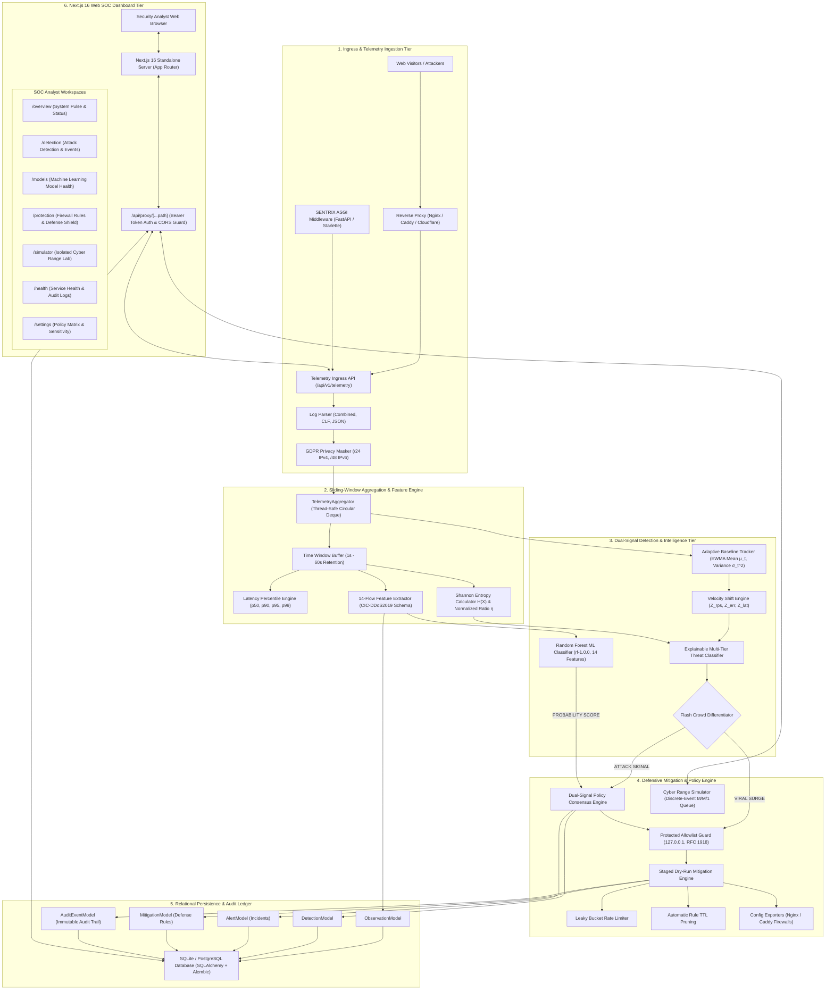
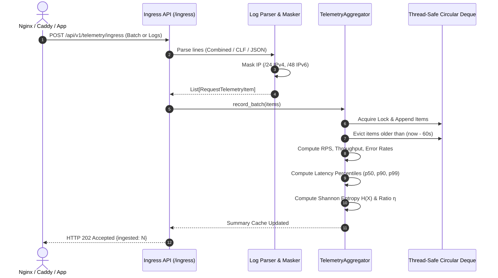
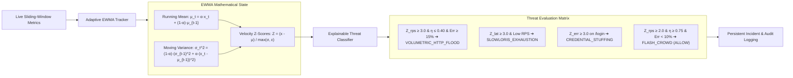
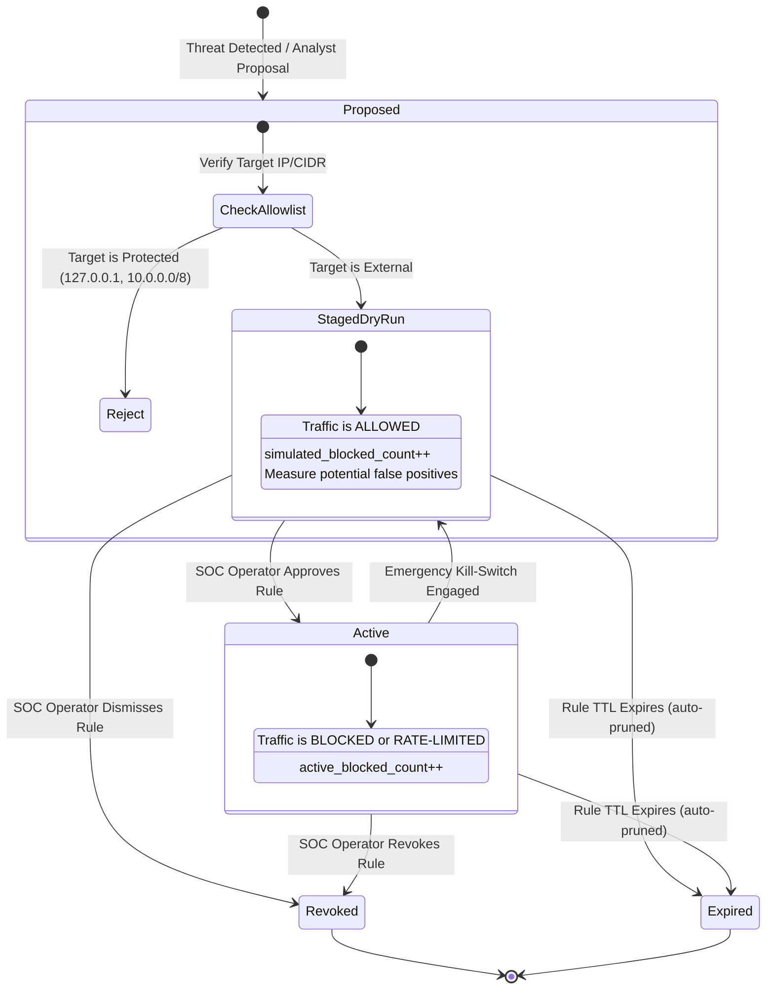

# SENTRIX — System Architecture & Design Specification

**System Name:** SENTRIX (Secure Enterprise Network Telemetry & Real-Time Incident X-Defend)  
**Architecture Version:** 2.0.0  
**Target Environment:** Real-World Web Infrastructures, Cloud Environments, and Cyber Ranges  

---

## 1. High-Level Architecture Overview

SENTRIX is an autonomous, real-time DDoS detection, monitoring, and defensive mitigation platform. It combines live HTTP telemetry streaming, adaptive statistical anomaly baselining (EWMA), explainable multi-tier threat classification, and staged defensive mitigation enforcement to safeguard web applications from malicious denial-of-service campaigns without harming legitimate visitors.

---

## 2. Ingestion & Sliding-Window Feature Pipeline

The telemetry ingress pipeline accepts both pre-aggregated metric objects and raw server logs. 

### Mathematical Definitions:
1. **Shannon Entropy of Client Distribution:**
   $$H(X) = -\sum_{i=1}^{n} P(x_i) \log_2 P(x_i)$$
   Where $P(x_i) = \frac{\text{requests from IP } i}{\text{total requests in window}}$.
2. **Normalized Entropy Ratio:**
   $$\eta = \frac{H(X)}{\log_2(n)} \quad (\text{for } n > 1)$$
   - $\eta \approx 0$: Concentrated traffic (single attacker or small cluster).
   - $\eta \approx 1$: Uniformly dispersed traffic across diverse IP space (Flash Crowd or Distributed Botnet).

---

## 3. Statistical Baseline & Multi-Tier Detection Engine

SENTRIX decouples anomaly detection from fixed static thresholds by tracking dynamic baseline behavior.

### Flash Crowd Differentiator:
When traffic surges ($Z_{rps} \ge 2.0$), legacy systems often trigger blanket rate limits, damaging legitimate marketing spikes. SENTRIX differentiates flash crowds through:
- **Entropy Ratio ($\eta \ge 0.75$):** Real humans arrive from varied geographic/ISP IP pools.
- **Client Count ($n \ge 5$):** Multi-source traffic distribution.
- **Error Rate ($< 10\%$):** Real users successfully access content with 200 OK responses.
- **Action:** Tagged as `FLASH_CROWD`, action `ALLOW`, zero collateral damage.

---

## 4. Defensive Mitigation Engine & Lifecycle

Defensive rules follow a strict safety lifecycle to prevent operator error or self-inflicted outages.

---

## 5. Security & Safety Invariants

1. **Allowlist Invariant:** Critical infrastructure (`127.0.0.1`, `10.0.0.0/8`, `172.16.0.0/12`, `192.168.0.0/16`, and healthcheck probes) can never be blocked. The engine enforces an immutable whitelist validation gate.
2. **Dry-Run by Default:** Newly proposed rules start in `DRY_RUN` mode. No traffic is actively dropped until an authenticated SOC operator explicitly approves the rule.
3. **Mandatory Rule TTL:** Every rule has an enforced expiration timestamp (default 300s). Expired rules are automatically purged by background cleanup to prevent indefinite blacklisting.
4. **Emergency Kill-Switch:** A global emergency switch (`set_emergency_disabled(True)`) bypasses all active mitigations in sub-millisecond execution time.
5. **Privacy by Default:** Raw IP addresses ingested into the telemetry pipeline are automatically masked to `/24` or `/48` subnets before storage or aggregation, ensuring compliance with privacy regulations.
6. **Immutable Audit Ledger:** Every rule proposal, approval, revocation, and automated threat alert writes an append-only record to `AuditEventModel`.
