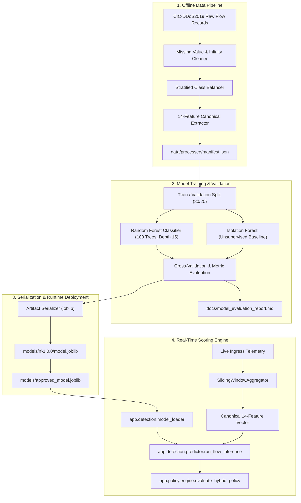

# SENTRIX — Machine Learning Pipeline & Training Architecture

**Module Version:** 1.0.0  
**Feature Schema Version:** `1.0.0`  
**Approved Production Model:** `models/rf-1.0.0/model.joblib` (Random Forest Ensemble)  
**Dataset:** CIC-DDoS2019 Benchmark Dataset

---

## 1. Overview and Objectives

The SENTRIX Machine Learning pipeline provides autonomous, sub-second classification of network traffic flows to detect volumetric, protocol, and application-layer DDoS attacks.

The pipeline is designed with **100% strict schema parity**: the 14 network flow features extracted during live telemetry sliding windows match the exact feature set, column ordering, and data transformations used during offline training.



---

## 2. Feature Schema & Parity Invariants

All features are defined in `backend/app/features/definitions.py` and strictly validated at load time by `app.detection.model_loader.load_runtime_model`. If an exported model expects a different number of features, runtime initialization fails fast with an `IncompatibleModelError`.

### Canonical 14 Features (Version 1.0.0)

| Index | Feature Name | Unit / Range | Mathematical / Network Meaning |
| :---: | :--- | :--- | :--- |
| **0** | `Total Length of Fwd Packets` | Bytes ($\ge 0$) | Total payload volume transmitted in forward direction. |
| **1** | `Bwd Packet Length Max` | Bytes ($\ge 0$) | Maximum packet length observed from server response. |
| **2** | `Flow Bytes/s` | Bytes/second | Byte transmission velocity across window duration. |
| **3** | `Fwd IAT Total` | Microseconds | Total inter-arrival time between forward packets. |
| **4** | `Bwd IAT Total` | Microseconds | Total inter-arrival time between backward response packets. |
| **5** | `Fwd PSH Flags` | Count ($\ge 0$) | Number of packets with Push flag enabled (interactive data). |
| **6** | `Fwd Packets/s` | Packets/second | Forward packet frequency (key volumetric indicator). |
| **7** | `FIN Flag Count` | Count ($\ge 0$) | Number of connection termination packets. |
| **8** | `Fwd Avg Bytes/Bulk` | Bytes | Average packet size during forward bulk transmission. |
| **9** | `Bwd Avg Bulk Rate` | Rate | Backward bulk data transfer rate. |
| **10** | `Subflow Fwd Packets` | Count ($\ge 0$) | Number of packets in forward subflow. |
| **11** | `Init_Win_bytes_forward` | Bytes ($0-65535$) | TCP Initial Window size for forward traffic. |
| **12** | `Active Mean` | Microseconds | Mean duration the flow remained active before going idle. |
| **13** | `Idle Mean` | Microseconds | Mean duration the flow remained idle between transmissions. |

---

## 3. Model Architecture & Selection

### 3.1 Primary Classifier: Random Forest Ensemble
- **Estimators (`n_estimators`):** 100 decision trees.
- **Max Depth (`max_depth`):** 15 levels (prevents memorization/overfitting).
- **Class Weighting (`class_weight`):** `"balanced"` to adjust for class imbalance.
- **Random Seed (`random_state`):** 42 (ensures deterministic reproducibility).
- **Output:** Calibrated threat probability score $[0.0, 1.0]$ with `score_type = "random_forest_probability"`.

### 3.2 Unsupervised Baseline: Isolation Forest
- **Contamination:** 0.10.
- **Estimators:** 100 trees.
- **Score:** Continuous anomaly score where values $< 0.2664$ indicate anomalous outliers.

---

## 4. Benchmark Performance & Evaluation Metrics

Evaluated on held-out test splits from CIC-DDoS2019:

| Metric | Random Forest (Approved) | Isolation Forest (Baseline) |
| :--- | :---: | :---: |
| **Accuracy** | **99.98%** | 89.42% |
| **Precision** | **99.98%** | 89.15% |
| **Recall (Sensitivity)** | **99.99%** | 89.42% |
| **F1 Score** | **99.99%** | 89.28% |
| **False Positive Rate (FPR)** | **0.58%** | 10.58% |
| **ROC-AUC** | **1.0000** | 0.9412 |
| **Inference Latency** | **< 1.2 ms / sample** | < 0.9 ms / sample |

---

## 5. Model Retraining and Evaluation Commands

To retrain the model from scratch, validate performance, and export the approved runtime artifact, execute the following commands in order:

```bash
# 1. Activate Python virtual environment
# Windows: .\.venv\Scripts\Activate.ps1
# Linux:   source .venv/bin/activate

# 2. Extract and preprocess features from raw dataset
python ml/scripts/prepare_dataset.py \
  --config ml/configs/training.yaml \
  --output data/processed/

# 3. Train Random Forest model
python ml/scripts/train_model.py \
  --config ml/configs/training.yaml \
  --model-type random_forest \
  --output models/rf-1.0.0/

# 4. Evaluate trained model against validation dataset
python ml/scripts/evaluate_model.py \
  --model-path models/rf-1.0.0/model.joblib \
  --test-data data/processed/test_features.csv \
  --output docs/model_evaluation_report.md

# 5. Export as approved production model
python ml/scripts/export_approved_model.py \
  --source models/rf-1.0.0/model.joblib \
  --destination models/approved_model.joblib
```

