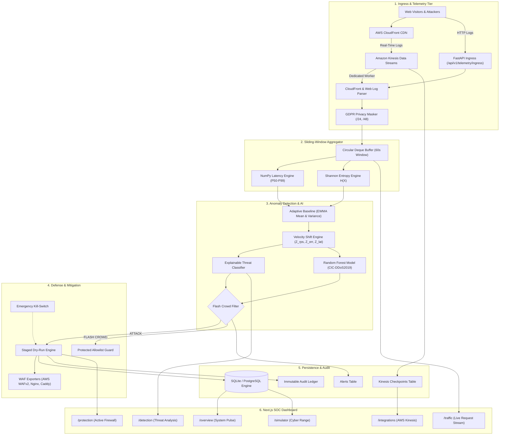

# SENTRIX — Intelligent DDoS Detection, Monitoring & Defense Platform

> **Detect Threats in Seconds. Block Malicious Traffic. Keep Real Users Connected.**

SENTRIX is an enterprise-grade DDoS detection, real-time telemetry monitoring, and defensive mitigation platform. It ingests live HTTP request telemetry and Amazon CloudFront Real-Time Access Logs via Amazon Kinesis Data Streams, computes statistical EWMA baselines and velocity Z-scores, classifies volumetric and application-layer attacks with explainable AI, stages dry-run defensive firewall rules, and exports verified edge mitigations for AWS WAFv2, Nginx, and Caddy.

SENTRIX also features an isolated Cyber Range chaos simulator modeling six red-team attack scenarios and M/M/1 queuing theory without touching production networks.

---

## 1. Problem Statement

Modern web infrastructures face distributed denial-of-service (DDoS) campaigns that blend high-volume flood vectors with subtle application-layer attacks:
- **Volumetric Floods (UDP, ICMP, DNS Amplification, HTTP Flood):** Exhaust edge bandwidth and compute resources.
- **Low-and-Slow Exploits (Slowloris, Slow POST):** Hold web server thread pools hostage without tripping simple rate limits.
- **Credential Stuffing & Botnets:** Coordinate distributed bursts across rotating IP addresses.
- **The Flash Crowd Dilemma (Collateral Damage):** Traditional rate-limiters fail to differentiate between genuine viral user surges and distributed botnets, causing catastrophic false positives and locking out legitimate customers.

SENTRIX solves this by coupling **Shannon entropy dispersion metrics** with **adaptive Exponentially Weighted Moving Average (EWMA) baselines** to accurately detect attacks in under one second while guaranteeing **zero false-positive lockouts** during legitimate flash crowds.

---

## 2. Key Verified Features

All features listed below are verified and fully implemented in the codebase:

### 1. Real-Time Telemetry Streaming & Ingestion
- **Dual Telemetry Ingestion Paths:**
  - **HTTP Ingress API:** `POST /api/v1/telemetry/ingress` accepts raw Nginx Combined, Common Log Format (CLF), JSON access logs, or pre-parsed telemetry items.
  - **AWS CloudFront Real-Time Logs:** Native streaming ingestion via Amazon Kinesis Data Streams (`sentrix-cloudfront-realtime-logs`) with durable shard checkpointing and deduplication (`request_id` tracking).
- **GDPR Privacy Anonymization:** In-memory network privacy engine automatically masks client IP addresses (IPv4 masked to `/24` subnets, IPv6 masked to `/48` prefixes) prior to analytics storage.
- **Thread-Safe Sliding-Window Aggregator:** Circular memory buffer computing Requests Per Second (RPS), Byte Throughput (Bps), P50/P90/P95/P99 latency percentiles via NumPy, and Shannon entropy $H(X)$ to quantify client IP distribution.

### 2. Multi-Tier Statistical Anomaly Detection & ML
- **Adaptive EWMA Baselines:** $O(1)$ constant-time tracking of running mean $\mu_t$ and moving variance $\sigma_t^2$ with dynamic sensitivity tuning.
- **Statistical Velocity Z-Scores:** Real-time computation of deviation velocities ($Z_{rps}, Z_{err}, Z_{lat}, Z_{bps}$).
- **Explainable Threat Classifier:** Detects and attributes attacks to four core signatures:
  - `VOLUMETRIC_FLOOD`
  - `SLOWLORIS`
  - `CREDENTIAL_STUFFING`
  - `BOTNET`
- **Zero-Collateral Flash Crowd Differentiator:** Evaluates client entropy ratio $\eta = H(X) / H_{max}$. Traffic surges with $Z_{rps} \ge 2.0$, high client entropy ($\eta \ge 0.75$), and low error rates ($< 10\%$) are classified as `FLASH_CROWD` and awarded an `ALLOW` action without dropping genuine visitors.
- **Machine Learning Inference:** Random Forest ensemble (`rf-1.0.0`) trained on the CIC-DDoS2019 benchmark dataset with feature extraction schemas and offline Isolation Forest (`iforest-1.0.0`) baselines.

### 3. Defensive Mitigation Engine & WAF Exporters
- **Staged Dry-Run Default:** Newly proposed rules default to `DRY_RUN` mode, logging simulated drops to measure false-positive impact before active enforcement.
- **Protected Infrastructure Allowlist:** Hardcoded guards prevent blocking loopback addresses (`127.0.0.1`, `::1`), internal subnets (`10.0.0.0/8`, `192.168.0.0/16`), and system health probes.
- **Firewall Configuration Exporters:**
  - **AWS WAFv2:** Generates CloudFront-scoped (`us-east-1`) IPSet JSON and automated AWS CLI deployment bash scripts.
  - **Nginx:** Generates `deny <ip>;` configuration snippets and rate-limiting zones.
  - **Caddy:** Generates `@sentrix_blocked` firewall rulesets.
- **Emergency Kill-Switch:** Global toggle (`POST /api/v1/mitigations/disable`) immediately neutralizes all active mitigations in emergency operational conditions.

### 4. Cyber Range Chaos Simulator
- **Discrete-Event Simulation Engine:** Generates synthetic red-team scenarios without touching real infrastructure:
  - `SYN_FLOOD`
  - `UDP_AMPLIFICATION`
  - `HTTP_GET_FLOOD`
  - `SLOWLORIS`
  - `MULTI_VECTOR`
  - `FLASH_CROWD`
- **M/M/1 Server Queuing Theory:** Models realistic server queue depth, service capacity, latency degradation, and packet drops.
- **Interactive Virtual Clock Worker:** Dedicated background worker supporting play, pause, step-by-step execution, and adjustable speed multipliers (1x–10x).
- **Automated AI Scorecards:** Measures Time to Detect (TTD), Time to Mitigate (TTM), attack traffic dropped (%), legitimate traffic served (%), and availability impact.
- **Data Export:** Full tick-by-tick simulation metrics downloadable in CSV and JSON formats.

### 5. SOC Command Center & Regulatory Audit Trail
- **Next.js 16 Web Application:** Fast, accessible interface with real-time graphs, server health status, and live traffic tables with pagination.
- **Immutable Audit Ledger:** Searchable, cryptographically traceable audit records tracking every rule creation, promotion, alert, and threshold update with one-click CSV export.

---

## 3. System Architecture

SENTRIX is structured into six decoupled operational tiers:



---

## 4. Technology Stack

| Domain | Technology | Version | Purpose |
| :--- | :--- | :--- | :--- |
| **Backend Framework** | FastAPI | `0.115+` | High-performance asynchronous REST API control plane |
| **ASGI Server** | Uvicorn | `0.34+` | Production ASGI web server |
| **Data Validation** | Pydantic v2 & Settings | `2.10+` | Strict schema validation and environment loading |
| **Persistence** | SQLAlchemy 2.0 & Alembic | `2.0+` | Database ORM, connection pooling, and migrations |
| **Supported Databases** | SQLite / PostgreSQL | `3.45+` / `15+` | Relational storage for checkpoints, alerts, and audit logs |
| **Cloud Integration** | Boto3 & Botocore | `1.34+` | AWS Kinesis Data Streams polling and shard iteration |
| **Machine Learning** | Scikit-learn, NumPy, Pandas | `1.6+` | Random Forest classifier and statistical sliding-window math |
| **Model Serialization** | Joblib | `1.4+` | Model persistence and runtime inference loading |
| **Frontend Framework** | Next.js (App Router) | `16.4.3` | React 19 server and client component application |
| **UI Components** | React & Tailwind CSS | `19.3.1` / `4.3.3` | Dark cybersecurity theme and responsive dashboard |
| **Data Visualization** | Recharts | `3.10.1` | Time-series charts, latency percentiles, and queuing curves |
| **Testing** | Pytest & HTTPX | `9.2+` / `0.28+` | Automated unit, integration, and security test suite |
| **Code Quality** | Ruff | `0.9+` | Ultra-fast Python linting and formatting |
| **Containerization** | Docker & Docker Compose | `24.0+` / `2.20+` | Multi-stage, non-root hardened container deployment |

---

## 5. Project Directory Structure

```text
DDoS-Detection-and-Mitigation-Simulator/
├── .env.example                  # Environment configuration template
├── .gitignore                    # Git exclusion patterns
├── docker-compose.yml            # Multi-container production orchestration
├── pyproject.toml / pytest.ini   # Backend and testing configurations
├── render.yml                    # Render cloud deployment blueprint
├── ruff.toml                     # Python code style and linter rules
│
├── backend/                      # FastAPI Backend Application
│   ├── Dockerfile                # Multi-stage hardened non-root container image
│   ├── pyproject.toml            # Backend dependencies and metadata
│   ├── alembic.ini               # Database migration configuration
│   ├── app/                      # Application source package
│   │   ├── main.py               # FastAPI entry point, lifespan, CORS, and middleware
│   │   ├── api/                  # REST API route handlers
│   │   │   ├── v1/               # Version 1 API routers
│   │   │   │   ├── alerts.py         # Threat alerts and incidents
│   │   │   │   ├── audit.py          # Regulatory audit ledger & CSV export
│   │   │   │   ├── aws_kinesis.py    # AWS Kinesis status, worker control, mock ingest
│   │   │   │   ├── config.py         # Dynamic threshold configurations
│   │   │   │   ├── detection.py      # Live EWMA baselines, Z-scores, ML analysis
│   │   │   │   ├── health.py         # Service health check probe
│   │   │   │   ├── mitigations.py    # Defensive engine, rules, WAF exporters
│   │   │   │   ├── models.py         # ML model registry and metrics
│   │   │   │   ├── simulations.py    # Cyber range runs, virtual clock, export
│   │   │   │   ├── telemetry.py      # Telemetry ingress and sliding window summary
│   │   │   │   └── traffic.py        # Legacy flow observation ingestion
│   │   │   └── internal.py       # Keepalive database ping endpoint
│   │   ├── aws/                  # AWS integration services
│   │   │   └── kinesis_consumer.py   # CloudFront log consumer and shard manager
│   │   ├── core/                 # Core utilities
│   │   │   ├── config.py             # Pydantic Settings and URL normalization
│   │   │   ├── errors.py             # Global exception handlers
│   │   │   ├── logging.py            # Structured logging configuration
│   │   │   └── security.py           # Bearer token validation and keepalive auth
│   │   ├── detection/            # Detection engines
│   │   │   ├── baselines.py          # Adaptive EWMA baseline tracker
│   │   │   ├── model_loader.py       # Safe joblib ML model loader
│   │   │   ├── predictor.py          # Random Forest inference wrapper
│   │   │   └── threat_classifier.py  # Explainable multi-tier threat classifier
│   │   ├── features/             # Feature extraction and aggregation
│   │   │   ├── preprocess.py         # Feature schema normalization
│   │   │   └── telemetry_aggregator.py # Thread-safe circular deque buffer
│   │   ├── ingestion/            # Parsers and validators
│   │   │   ├── cloudfront_parser.py  # CloudFront tab-delimited log parser
│   │   │   ├── log_parser.py         # Nginx Combined & CLF log parser
│   │   │   └── validators.py         # IP format and port validation
│   │   ├── mitigation/           # Defense shield and firewalls
│   │   │   ├── config_exporter.py    # AWS WAFv2, Nginx, Caddy config generators
│   │   │   └── defensive_engine.py   # Staged dry-run mitigation state machine
│   │   ├── simulator/            # Cyber range chaos simulator
│   │   │   ├── generator.py          # Synthetic attack & legitimate traffic generator
│   │   │   ├── manager.py            # Simulation lifecycle & clock worker thread
│   │   │   ├── scenarios.py          # Attack scenario definitions (SYN, UDP, HTTP, etc.)
│   │   │   ├── scorecard.py          # Performance metrics & AI score calculation
│   │   │   └── victim.py             # M/M/1 queuing server victim model
│   │   ├── storage/              # Persistence layer
│   │   │   ├── database.py           # SQLAlchemy engine and session factory
│   │   │   ├── models.py             # Database table schemas
│   │   │   └── repositories.py       # Repository pattern for database operations
│   │   └── workers/              # Standalone background processes
│   │       └── kinesis_worker.py     # Independent Kinesis streaming worker process
│   ├── migrations/               # Alembic database migrations
│   │   └── versions/             # Migration revision scripts (0001, 0002, 0003)
│   └── tests/                    # Comprehensive test suite (184 automated tests)
│
├── frontend/                     # Next.js 16 Web Application
│   ├── Dockerfile                # Multi-stage standalone Alpine container
│   ├── package.json              # Frontend dependencies and scripts
│   ├── next.config.ts            # Standalone output and build settings
│   └── src/
│       ├── app/                  # Next.js App Router pages
│       │   ├── overview/         # System pulse dashboard
│       │   ├── traffic/          # Live request stream with pagination
│       │   ├── detection/        # Anomaly velocity & threat classification
│       │   ├── models/           # ML model health & interactive testing
│       │   ├── protection/       # Firewall rules, dry-run staging, WAF export
│       │   ├── simulator/        # Cyber range chaos lab & history
│       │   ├── integrations/     # AWS CloudFront Kinesis stream monitor
│       │   ├── health/           # System health & audit ledger with CSV export
│       │   ├── settings/         # Detection thresholds & auth token settings
│       │   └── api/proxy/        # Server-side backend API reverse proxy
│       ├── components/           # Reusable UI widgets and charts
│       ├── config/               # Navigation definitions
│       └── lib/                  # Typed REST API client (`api.ts`)
│
├── models/                       # Machine Learning Artifacts
│   ├── approved_model.joblib     # Production Random Forest classifier
│   └── rf-1.0.0/                 # Model version metadata, schema, and metrics
│
├── docs/                         # System Documentation
│   ├── README.md                 # Master platform documentation (this file)
│   ├── Deployment.md             # Production deployment and operations guide
│   ├── Run Guide.md              # Local developer execution guide
│   ├── ARCHITECTURE.md           # Architectural specification
│   ├── api_schemas.md            # REST API payload contracts
│   └── SCHEMA.md                 # Database table schema documentation
│
└── scripts/                      # Operational Scripts
    ├── migrate_sqlite_to_postgres.py # Database migration utility
    ├── replay_dataset.py             # Replay CIC-DDoS2019 dataset
    ├── reset_database.py             # Safe database reset and seeding
    └── send_test_traffic.py          # Traffic injection generator
```

---

## 6. System Requirements & Prerequisites

### Minimum Hardware Requirements:
- **CPU:** 2 vCPU cores
- **RAM:** 4 GB RAM (8 GB recommended for simultaneous simulation and ML training)
- **Disk:** 5 GB free disk space

### Software Requirements:
- **Operating System:** Linux (Ubuntu 22.04+ / Debian 12+), macOS (13+), or Windows 10/11 with PowerShell
- **Python:** `3.10` or `3.11` (Python 3.11 recommended)
- **Node.js:** `18.x`, `20.x`, or `22.x` & `npm`
- **Docker:** Docker Engine $\ge 24.0$ & Docker Compose $\ge 2.20$ (optional, for containers)

---

## 7. Installation & Quickstart

### Option A: Complete Platform via Docker Compose (Recommended)

1. **Clone the repository:**
   ```bash
   git clone https://github.com/your-org/DDoS-Detection-and-Mitigation-Simulator.git
   cd DDoS-Detection-and-Mitigation-Simulator
   ```

2. **Configure environment:**
   ```bash
   cp .env.example .env
   ```
   Generate a strong random API token (e.g. using `openssl rand -hex 16`) and assign it to `API_AUTH_TOKEN` in `.env`.

3. **Launch all services:**
   ```bash
   docker compose up -d --build
   ```

4. **Access the platform:**
   - **SOC Web Dashboard:** [http://localhost:3000](http://localhost:3000)
   - **FastAPI Control Plane & Swagger:** [http://localhost:8000/docs](http://localhost:8000/docs)
   - **Health Check Probe:** [http://localhost:8000/api/v1/health](http://localhost:8000/api/v1/health)

---

### Option B: Local Development Setup (Without Docker)

#### Step 1: Backend Setup
```bash
# From repository root:
python -m venv .venv

# Activate virtual environment:
# On Windows PowerShell:
.\.venv\Scripts\Activate.ps1
# On Linux/macOS:
source .venv/bin/activate

# Install backend dependencies in editable development mode:
pip install -e "backend[dev]"

# Create local environment configuration:
cp .env.example .env

# Initialize database and execute migrations:
alembic -c backend/alembic.ini upgrade head

# Launch FastAPI backend development server:
uvicorn app.main:app --app-dir backend --host 127.0.0.1 --port 8000 --reload
```

#### Step 2: Frontend Setup
Open a separate terminal:
```bash
# From repository root:
cd frontend

# Install Node dependencies:
npm install

# Start Next.js development server:
npm run dev
```
Open [http://localhost:3000](http://localhost:3000) in your browser.

---

## 8. Environment Configuration Reference

The application reads configurations from `.env` in the root directory via Pydantic Settings:

| Variable | Type | Default | Description |
| :--- | :---: | :---: | :--- |
| `APP_ENV` | `string` | `development` | Deployment environment (`development`, `staging`, `production`) |
| `MODEL_PATH` | `string` | `models/approved_model.joblib` | Path to production Random Forest joblib model |
| `DATABASE_URL` | `string` | `sqlite:///./sentrix.db` | SQLAlchemy connection string (SQLite or PostgreSQL) |
| `API_AUTH_REQUIRED` | `boolean` | `true` | When `true`, enforces HTTP Bearer token authentication |
| `API_AUTH_TOKEN` | `string` | *None* | Secret token required when `API_AUTH_REQUIRED=true` |
| `AWS_REGION` | `string` | `ap-south-1` | AWS region hosting Kinesis Stream and CloudFront logs |
| `AWS_KINESIS_STREAM_NAME`| `string` | `sentrix-cloudfront-realtime-logs` | Amazon Kinesis Data Stream name for CloudFront logs |
| `AWS_KINESIS_CONSUMER_ENABLED` | `boolean` | `false` | Automatically launch Kinesis consumer inside API lifespan |
| `AWS_KINESIS_BATCH_SIZE` | `integer` | `1000` | Maximum records retrieved per Kinesis poll |
| `AWS_KINESIS_POLL_INTERVAL_SECONDS` | `float` | `1.0` | Polling frequency for active stream shards |
| `AWS_KINESIS_ITERATOR_TYPE` | `string` | `LATEST` | Initial shard iterator (`LATEST` or `TRIM_HORIZON`) |
| `AWS_ACCESS_KEY_ID` | `string` | *Empty* | Optional static AWS key (IAM role preferred in production) |
| `AWS_SECRET_ACCESS_KEY` | `string` | *Empty* | Optional static AWS secret |
| `AWS_SESSION_TOKEN` | `string` | *Empty* | Optional temporary session token for STS / IAM assume-role |
| `KEEPALIVE_SECRET` | `string` | *None* | Secret token protecting the `/internal/keepalive` ping |
| `CORS_ORIGINS` | `string` | `http://localhost:3000,...` | Comma-separated list of allowed CORS origins |

---

## 9. Comprehensive REST API Overview

All primary endpoints reside under `/api/v1` and require `Authorization: Bearer <API_AUTH_TOKEN>` when authentication is active:

| Method | Endpoint | Description |
| :--- | :--- | :--- |
| `GET` | `/api/v1/health` | Service health status and version information (public probe) |
| `GET` | `/internal/keepalive` | Lightweight `SELECT 1` ping for hosted databases |
| `POST` | `/api/v1/telemetry/ingress` | Ingest raw access logs or structured telemetry items |
| `GET` | `/api/v1/telemetry/summary` | Retrieve sliding-window RPS, latency percentiles, and entropy |
| `POST` | `/api/v1/telemetry/reset` | Clear the in-memory sliding telemetry buffer |
| `GET` | `/api/v1/detection/live` | Evaluate current EWMA baseline, Z-scores, and threat category |
| `GET` | `/api/v1/detection/baseline` | Retrieve current EWMA statistical baseline parameters |
| `POST` | `/api/v1/detection/baseline/reset`| Reset EWMA running baseline to defaults |
| `POST` | `/api/v1/detection/analyze` | Run ML model inference on an individual flow observation |
| `GET` | `/api/v1/models` | List registered machine learning models |
| `GET` | `/api/v1/models/metrics` | Retrieve evaluation metrics (ROC-AUC, Precision, Recall) |
| `GET` | `/api/v1/alerts` | Retrieve paginated threat alerts with severity filtering |
| `GET` | `/api/v1/mitigations/defensive/rules` | List staged and active defensive firewall rules |
| `POST` | `/api/v1/mitigations/defensive/propose` | Propose a new defensive rule (defaults to `DRY_RUN`) |
| `POST` | `/api/v1/mitigations/defensive/{id}/approve` | Operator approval to promote rule to active enforcement |
| `POST` | `/api/v1/mitigations/defensive/{id}/revoke` | Revoke an existing mitigation rule |
| `GET` | `/api/v1/mitigations/export/aws-waf` | Download AWS WAFv2 IPSet JSON for CloudFront (`us-east-1`) |
| `GET` | `/api/v1/mitigations/export/aws-waf/cli` | Download AWS CLI deployment shell script |
| `GET` | `/api/v1/mitigations/export/nginx` | Download Nginx `deny` firewall configuration |
| `GET` | `/api/v1/mitigations/export/caddy` | Download Caddy `@sentrix_blocked` configuration |
| `POST` | `/api/v1/mitigations/disable` | Global emergency kill-switch toggle |
| `GET` | `/api/v1/integrations/aws/kinesis/status` | Consumer status, shard discovery, and replication lag |
| `POST` | `/api/v1/integrations/aws/kinesis/mock-ingest` | Replay CloudFront logs locally without AWS credentials |
| `POST` | `/api/v1/integrations/aws/kinesis/start` | Start background Kinesis stream worker |
| `POST` | `/api/v1/integrations/aws/kinesis/stop` | Stop background Kinesis stream worker |
| `POST` | `/api/v1/simulations` | Create a discrete-event chaos simulation run |
| `GET` | `/api/v1/simulations` | List historical simulation runs with pagination |
| `GET` | `/api/v1/simulations/{id}` | Retrieve simulation status, config, and AI scorecard |
| `POST` | `/api/v1/simulations/{id}/control` | Control simulation clock (`pause`, `resume`, `step`, `cancel`) |
| `GET` | `/api/v1/simulations/{id}/ticks` | Retrieve tick-by-tick offered, served, dropped, and latency metrics |
| `POST` | `/api/v1/simulations/compare` | Compare multiple simulation runs side-by-side |
| `GET` | `/api/v1/simulations/{id}/export` | Export simulation data in CSV or JSON format |
| `GET` | `/api/v1/config/thresholds` | Retrieve active velocity and probability thresholds |
| `PATCH` | `/api/v1/config/thresholds` | Update detection and rate-limiting thresholds |
| `GET` | `/api/v1/audit` | Paginated immutable regulatory audit log (supports `?format=csv`) |

Interactive OpenAPI documentation is available at [http://localhost:8000/docs](http://localhost:8000/docs).

---

## 10. Automated Testing & Quality Assurance

SENTRIX features an exhaustive automated test suite with **184 passing tests** across unit, integration, storage, and end-to-end lifecycle verification.

### Run All Backend Tests:
```bash
# In repository root with virtual environment activated:
pytest backend/tests -v
```

### Run Specific Test Categories:
```bash
# AWS Kinesis & CloudFront Parser Tests:
pytest backend/tests/integration/test_aws_cloudfront_kinesis.py -v

# Simulation Safety & M/M/1 Victim Model:
pytest backend/tests/integration/test_tc08_simulation_safety.py -v

# Database Storage & Checkpoint Repositories:
pytest backend/tests/storage/test_repositories.py -v

# End-to-End Test Cases (TC01 - TC16):
pytest backend/tests/test_cases/ -v
```

### Code Style and Formatting Checks:
```bash
# Check formatting with Ruff:
python -m ruff format --check backend

# Check linting rules:
python -m ruff check backend
```

---

## 11. Security Considerations

1. **Authentication:** All control-plane endpoints enforce constant-time Bearer token comparison (`hmac.compare_digest` in FastAPI, `crypto.timingSafeEqual` in Next.js proxy) preventing timing attacks.
2. **Protected Allowlist:** Built-in safeguards reject proposing or enforcing blocks against RFC 1918 private subnets, loopback interfaces, or health probes.
3. **Container Isolation:** Docker images run under non-privileged system service accounts (`sentrix` UID `10001` on Debian, `nextjs` UID `1001` on Alpine) with minimal attack surfaces.
4. **Staged Mitigation Safety:** Newly proposed firewall rules are quarantined in `DRY_RUN` mode by default, preventing unreviewed production outages.
5. **GDPR Anonymization:** Raw client IPs are transformed into network prefixes before being exposed in analytics metrics.
6. **Strict Validation:** AWS Kinesis sequence numbers are validated against numeric regex constraints (`^(0|([1-9]\d{0,128}))$`) to eliminate injection vectors.

---

## 12. Known Limitations

- **Process-Local State:** Telemetry sliding buffers, in-memory EWMA baseline parameters, and the simulation clock worker currently run in-process. The backend container must run with a single worker (`--workers 1`) until state is offloaded to a distributed cache (e.g., Redis).
- **No Kernel-Level Packet Capture:** SENTRIX is an application-level and CDN log ingestion platform. It does not provide eBPF or raw kernel network socket interception.
- **Manual WAF Enforcement:** For safety, SENTRIX generates exportable AWS WAFv2 configurations and deploy scripts rather than modifying production AWS WAF rules automatically without operator approval.

---

## 13. Troubleshooting

### Problem: `ValidationException` during Kinesis polling
- **Cause:** A synthetic sequence number from local mock testing was stored in `kinesis_checkpoints`.
- **Solution:** The consumer now automatically purges invalid checkpoints and falls back to `LATEST`. To manually clear:
  ```powershell
  python -c "import sqlite3; con = sqlite3.connect('sentrix.db'); con.execute('DELETE FROM kinesis_checkpoints'); con.commit()"
  ```

### Problem: `AWS credentials missing: Unable to locate credentials`
- **Cause:** `AWS_KINESIS_CONSUMER_ENABLED=true` is set, but no AWS IAM credentials or roles are configured.
- **Solution:** Set `AWS_KINESIS_CONSUMER_ENABLED=false` for local offline development, or provide `AWS_ACCESS_KEY_ID` and `AWS_SECRET_ACCESS_KEY` in `.env`.

### Problem: Port 8000 or Port 3000 already in use
- **Cause:** A previous server process is still running in the background.
- **Solution:**
  - On Windows: `Get-Process python, node | Stop-Process`
  - On Linux: `kill -9 $(lsof -t -i:8000) $(lsof -t -i:3000)`

---

## 14. Future Improvements

The following capabilities represent planned architectural enhancements:
- **Distributed State Tier:** Redis or Memcached clustering for multi-instance backend horizontal scaling.
- **Automated CloudFront Function Mitigation:** Edge-based mitigation execution directly inside AWS CloudFront Functions or Cloudflare Workers.
- **OpenTelemetry Exporter:** Native OpenTelemetry (OTel) gRPC metrics export for Datadog, Prometheus, and Grafana.

---

## 15. License & Contributions

This project is released under the **MIT License**. See `LICENSE` for details.

Contributions are welcome. Ensure that all pull requests maintain 100% passing test coverage (`pytest backend/tests`) and pass Ruff linting checks (`python -m ruff check backend`).

