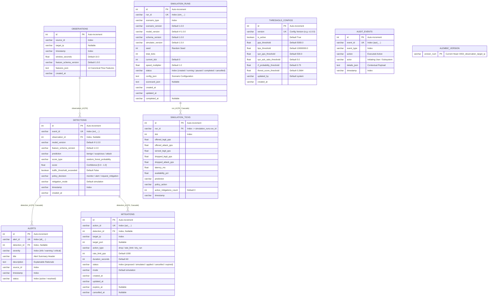

# SENTRIX Database Architecture & Entity-Relationship Schema

## Overview

SENTRIX uses **SQLAlchemy 2.0 ORM** as its persistence layer, providing a unified database abstraction supporting two production-grade dialects:

- **Supabase PostgreSQL (15+)** — Cloud database supporting both direct pooler connections (Session mode on port `5432` for Alembic migrations, Transaction mode on port `6543` for high-concurrency API pooling).
- **SQLite 3** — Zero-configuration local database for local development, CI/CD automated test suites, and isolated staging environments.

The database stores incoming network observations, machine-learning classification results, security alerts, mitigation actions, detection thresholds, structured audit history, and chaos simulation metrics.

---

## 1. Visual Entity-Relationship (ER) Diagram



---

## 2. Relational Cardinality & Cascade Semantics

| Parent Table | Child Table | Foreign Key | Cascade Rule | Cardinality | Architectural Purpose |
| :--- | :--- | :--- | :--- | :---: | :--- |
| `observations` | `detections` | `observation_id` | `all, delete-orphan` | 1-to-N | One network observation can undergo multiple model inferences or evaluation passes. |
| `detections` | `alerts` | `detection_id` | `all, delete-orphan` | 1-to-N | A single detection event can trigger one or more prioritized security incident alerts. |
| `detections` | `mitigations` | `detection_id` | `all, delete-orphan` | 1-to-N | An attack detection can propose multiple defensive actions (e.g. rate limit + IP drop). |
| `simulation_runs` | `simulation_ticks` | `run_id` | `all, delete-orphan` | 1-to-N | A chaos test run contains sequential time-series ticks recording offered vs dropped traffic. |

> **Enforcement Note:** Standalone tables `threshold_configs`, `audit_events`, and `alembic_version` operate independently without foreign-key dependencies to guarantee zero-overhead query throughput and preserve audit integrity.

---

## 3. Comprehensive Table & Column Reference

### 3.1 `observations`
Stores sliding-window HTTP telemetry and network flow summaries.

| Column | Type | Nullable | Index / Constraint | Purpose & Mathematical Description |
| :--- | :--- | :---: | :---: | :--- |
| `id` | `INTEGER` | No | `PRIMARY KEY` | Auto-incrementing internal surrogate identifier. |
| `source_id` | `VARCHAR(64)` | No | `INDEX` | Unique sensor, proxy, or host identifier reporting telemetry. |
| `target_ip` | `VARCHAR(64)` | Yes | — | Target server IP or destination service under observation. |
| `timestamp` | `VARCHAR(32)` | No | `INDEX` | ISO 8601 UTC timestamp of the observation window. |
| `window_seconds`| `FLOAT` | No | Default `10.0` | Duration of the sliding time window in seconds. |
| `feature_schema_version` | `VARCHAR(16)` | No | Default `1.0.0` | Schema version defining the 14 extracted flow features. |
| `features_json` | `TEXT` | No | — | Serialized JSON containing the 14 canonical CIC-DDoS2019 features. |
| `created_at` | `VARCHAR(32)` | No | — | Database record insertion timestamp. |

---

### 3.2 `detections`
Stores inference assessments produced by ML models and the dual-signal policy engine.

| Column | Type | Nullable | Index / Constraint | Purpose & Mathematical Description |
| :--- | :--- | :---: | :---: | :--- |
| `id` | `INTEGER` | No | `PRIMARY KEY` | Auto-incrementing identifier. |
| `event_id` | `VARCHAR(64)` | No | `UNIQUE`, `INDEX` | Global detection event identifier (`evt_<hex12>`). |
| `observation_id`| `INTEGER` | Yes | `FK`, `INDEX` | References `observations.id` (nullable for direct API evaluations). |
| `model_version` | `VARCHAR(32)` | No | Default `rf-1.0.0` | Serialized model artifact version used for prediction. |
| `feature_schema_version`| `VARCHAR(16)`| No | Default `1.0.0` | Feature schema version evaluated. |
| `prediction` | `VARCHAR(32)` | No | — | Model classification label: `normal`, `suspicious`, or `attack`. |
| `score_type` | `VARCHAR(64)` | No | — | Metric type: `random_forest_probability` or `isolation_forest_anomaly_score`. |
| `score` | `FLOAT` | No | — | Raw model score $[0.0, 1.0]$. |
| `traffic_threshold_exceeded`| `BOOLEAN`| No | Default `False` | Whether volumetric or velocity thresholds were breached. |
| `policy_decision` | `VARCHAR(64)` | No | — | Evaluated consensus action: `monitor`, `alert`, or `request_mitigation`. |
| `mitigation_mode` | `VARCHAR(32)` | No | Default `simulation`| Operational mode: `simulation` or `enforcement`. |
| `timestamp` | `VARCHAR(32)` | No | `INDEX` | ISO 8601 UTC detection timestamp. |
| `created_at` | `VARCHAR(32)` | No | — | Insertion timestamp. |

---

### 3.3 `alerts`
Stores actionable security incident notifications surfaced on the SOC dashboard.

| Column | Type | Nullable | Index / Constraint | Purpose & Mathematical Description |
| :--- | :--- | :---: | :---: | :--- |
| `id` | `INTEGER` | No | `PRIMARY KEY` | Auto-incrementing identifier. |
| `alert_id` | `VARCHAR(64)` | No | `UNIQUE`, `INDEX` | Unique incident identifier (`alt_<hex12>`). |
| `detection_id`| `INTEGER` | Yes | `FK`, `INDEX` | References `detections.id`. |
| `severity` | `VARCHAR(16)` | No | `INDEX` | Urgency tier: `info`, `low`, `medium`, `high`, `critical`. |
| `title` | `VARCHAR(256)`| No | — | Short incident summary (e.g. `Live Threat: VOLUMETRIC_HTTP_FLOOD`). |
| `description`| `TEXT` | No | — | Explainable root-cause rationale and contributing Z-score metrics. |
| `source_id` | `VARCHAR(64)` | No | `INDEX` | Sensor identifier or simulation run ID (`sim_<run_id>`). |
| `timestamp` | `VARCHAR(32)` | No | `INDEX` | ISO 8601 UTC occurrence timestamp. |
| `status` | `VARCHAR(32)` | No | `INDEX`, Default `active`| Lifecycle state: `active`, `resolved`, or `cancelled`. |

---

### 3.4 `mitigations`
Tracks defensive firewall rules and rate-limiting actions across their lifecycle.

| Column | Type | Nullable | Index / Constraint | Purpose & Mathematical Description |
| :--- | :--- | :---: | :---: | :--- |
| `id` | `INTEGER` | No | `PRIMARY KEY` | Auto-incrementing identifier. |
| `action_id` | `VARCHAR(64)` | No | `UNIQUE`, `INDEX` | Unique mitigation identifier (`act_<hex12>`). |
| `detection_id`| `INTEGER` | Yes | `FK`, `INDEX` | References `detections.id`. |
| `target_ip` | `VARCHAR(64)` | No | `INDEX` | Offending client IP address or CIDR subnet to mitigate. |
| `target_port`| `INTEGER` | Yes | — | Protocol destination port (nullable for all-port drops). |
| `action_type`| `VARCHAR(32)` | No | Default `rate_limit`| Defensive action: `drop`, `rate_limit`, or `dry_run`. |
| `rate_limit_pps`| `INTEGER` | No | Default `1000` | Packet rate quota enforced if rate limited. |
| `duration_seconds`| `INTEGER` | No | Default `60` | Scheduled Time-To-Live duration. |
| `status` | `VARCHAR(32)` | No | `INDEX`, Default `proposed`| Lifecycle state: `proposed`, `simulated`, `applied`, `cancelled`, `expired`. |
| `mode` | `VARCHAR(32)` | No | Default `simulation`| Mode: `simulation` or `enforcement`. |
| `created_at` | `VARCHAR(32)` | No | — | Rule generation timestamp. |
| `updated_at` | `VARCHAR(32)` | No | — | Last modification timestamp. |
| `expires_at` | `VARCHAR(32)` | Yes | — | Absolute ISO 8601 timestamp when rule auto-expires. |
| `cancelled_at`| `VARCHAR(32)` | Yes | — | Timestamp when an analyst manually cancelled the rule. |

---

### 3.5 `threshold_configs`
Stores dynamic operational ceilings and sensitivity parameters for the dual-signal policy engine.

| Column | Type | Nullable | Index / Constraint | Purpose & Mathematical Description |
| :--- | :--- | :---: | :---: | :--- |
| `id` | `INTEGER` | No | `PRIMARY KEY` | Auto-incrementing identifier. |
| `version` | `VARCHAR(32)` | No | `UNIQUE` | Configuration version tag (e.g. `v1.0.0`, `v<hex6>`). |
| `is_active` | `BOOLEAN` | No | Default `True` | Flag indicating the active threshold row (only 1 active at a time). |
| `pps_threshold`| `FLOAT` | No | Default `5000.0` | Packets per second ceiling. |
| `bps_threshold`| `FLOAT` | No | Default `10000000.0`| Byte throughput ceiling (10 Mbps). |
| `syn_pps_threshold`| `FLOAT` | No | Default `500.0` | Forward SYN packet rate ceiling. |
| `syn_ack_ratio_threshold`| `FLOAT`| No | Default `5.0` | SYN-to-ACK imbalance ratio ceiling. |
| `rf_probability_threshold`| `FLOAT`| No | Default `0.75` | Random Forest threat probability cutoff. |
| `iforest_score_threshold`| `FLOAT`| No | Default `0.2664` | Isolation Forest anomaly score cutoff. |
| `updated_by` | `VARCHAR(64)` | No | Default `system` | Identity of operator or automated tuner. |
| `created_at` | `VARCHAR(32)` | No | — | Creation timestamp. |

---

### 3.6 `audit_events`
An append-only compliance ledger tracking all administrative, defense, and system actions.

| Column | Type | Nullable | Index / Constraint | Purpose & Mathematical Description |
| :--- | :--- | :---: | :---: | :--- |
| `id` | `INTEGER` | No | `PRIMARY KEY` | Auto-incrementing identifier. |
| `event_id` | `VARCHAR(64)` | No | `UNIQUE`, `INDEX` | Unique audit event identifier (`aud_<hex12>`). |
| `event_type` | `VARCHAR(64)` | No | `INDEX` | Category: `alert_created`, `rule_approved`, `rule_revoked`, `kill_switch_engaged`. |
| `action` | `VARCHAR(64)` | No | — | Executed operation name. |
| `actor` | `VARCHAR(64)` | No | — | Operator username or automated agent (`sentrix_detection_engine`). |
| `details_json`| `TEXT` | No | — | Serialized JSON payload capturing before/after state and metadata. |
| `timestamp` | `VARCHAR(32)` | No | `INDEX` | High-precision ISO 8601 UTC timestamp. |

---

### 3.7 `simulation_runs`
Stores metadata and configurations for chaos testing experiments in the Cyber Range sandbox.

| Column | Type | Nullable | Index / Constraint | Purpose & Mathematical Description |
| :--- | :--- | :---: | :---: | :--- |
| `id` | `INTEGER` | No | `PRIMARY KEY` | Auto-incrementing identifier. |
| `run_id` | `VARCHAR(64)` | No | `UNIQUE`, `INDEX` | Unique simulation run identifier (`sim_<hex12>`). |
| `scenario_type`| `VARCHAR(32)` | No | `INDEX` | Scenario: `syn_flood`, `udp_amplification`, `http_flood`, `flash_crowd`. |
| `scenario_version`| `VARCHAR(16)`| No | Default `1.0.0` | Scenario definition version. |
| `model_version`| `VARCHAR(32)` | No | Default `rf-1.0.0` | ML model evaluated during the run. |
| `schema_version`| `VARCHAR(16)`| No | Default `1.0.0` | Feature schema version. |
| `simulator_version`| `VARCHAR(16)`| No | Default `1.5.0`| Queuing engine version. |
| `seed` | `INTEGER` | No | — | PRNG seed ensuring reproducible traffic patterns. |
| `total_ticks` | `INTEGER` | No | — | Planned execution steps (typically 60 ticks). |
| `current_tick`| `INTEGER` | No | Default `0` | Current progress tick. |
| `speed_multiplier`| `FLOAT`| No | Default `1.0` | Simulation playback speed multiplier (1x, 2x, 5x). |
| `status` | `VARCHAR(32)` | No | `INDEX`, Default `created`| State: `created`, `running`, `paused`, `completed`, `cancelled`. |
| `config_json` | `TEXT` | No | — | Full victim and attack parameters in JSON format. |
| `scorecard_json`| `TEXT` | Yes | — | Final evaluation scorecard (TTD, TTM, drop efficiency). |
| `created_at` | `VARCHAR(32)` | No | — | Creation timestamp. |
| `updated_at` | `VARCHAR(32)` | No | — | Last tick update timestamp. |
| `completed_at`| `VARCHAR(32)` | Yes | — | Completion timestamp. |

---

### 3.8 `simulation_ticks`
Contains per-tick time-series telemetry powering real-time simulation graphs and performance scorecards.

| Column | Type | Nullable | Index / Constraint | Purpose & Mathematical Description |
| :--- | :--- | :---: | :---: | :--- |
| `id` | `INTEGER` | No | `PRIMARY KEY` | Auto-incrementing identifier. |
| `run_id` | `VARCHAR(64)` | No | `FK`, `INDEX` | References `simulation_runs.run_id`. |
| `tick` | `INTEGER` | No | `INDEX` | Sequential step number ($0 \dots \text{total\_ticks}-1$). |
| `offered_legit_pps`| `FLOAT` | No | — | Genuine customer traffic rate offered to system. |
| `offered_attack_pps`| `FLOAT`| No | — | Malicious botnet traffic rate offered to system. |
| `served_legit_pps`| `FLOAT` | No | — | Legitimate traffic successfully processed by victim server. |
| `dropped_legit_pps`| `FLOAT`| No | — | Collateral damage (legitimate traffic dropped by defense). |
| `dropped_attack_pps`| `FLOAT`| No | — | Malicious packets successfully filtered by defense shield. |
| `latency_ms` | `FLOAT` | No | — | Simulated server M/M/1 queuing response latency. |
| `availability_pct`| `FLOAT` | No | — | Server health & request fulfillment ratio ($0.0 - 100.0\%$). |
| `prediction` | `VARCHAR(32)` | No | — | Real-time classification: `benign` or `attack`. |
| `policy_action`| `VARCHAR(32)` | No | — | Engine action: `monitor`, `alert`, or `simulate_mitigation`. |
| `active_mitigations_count`| `INTEGER`| No | Default `0` | Number of active virtual firewall rules at this tick. |
| `timestamp` | `VARCHAR(32)` | No | — | Real-world ISO 8601 UTC execution timestamp. |

---

### 3.9 `alembic_version`
Internal migration metadata maintained automatically by Alembic.

| Column | Type | Nullable | Constraint | Current Applied Revision |
| :--- | :--- | :---: | :---: | :--- |
| `version_num` | `VARCHAR(32)` | No | `PRIMARY KEY` | `0002_observation_target_ip` (Head) |

---

## 4. Alembic Migration History

The database schema evolution is strictly versioned through Alembic migrations located in `backend/migrations/versions/`:

```
[0001_initial]
  └── Creates: observations, detections, alerts, mitigations,
               threshold_configs, audit_events, simulation_runs, simulation_ticks
        │
[0002_observation_target_ip]  (HEAD)
  └── Adds: target_ip column to observations table
```

> **Cloud-Agnostic Note:** The legacy revision `0003_aws_cloudfront_kinesis.py` has been completely deleted. The schema is 100% decoupled from AWS and requires no proprietary cloud provider tables.
