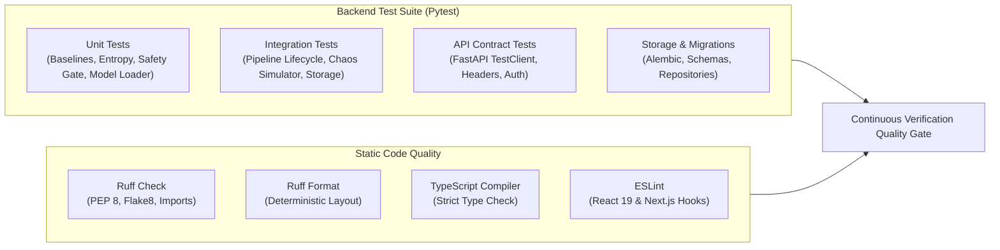

# SENTRIX — Testing & Quality Assurance Guide

**Scope:** Unit Tests, Integration Tests, End-to-End Pipeline Verification, Static Analysis, and Frontend Quality Audits.

---

## 1. Testing Architecture & Philosophy

The SENTRIX verification harness guarantees system safety, numerical correctness, and API reliability across the defense lifecycle:



---

## 2. Test Suite Directory Structure

```
backend/tests/
├── api/                                # FastAPI route contract tests
│   ├── test_alerts_api.py              # Alert querying and pagination
│   ├── test_auth.py                    # Token verification & unauthorized checks
│   ├── test_health.py                  # Health check & DB connectivity
│   ├── test_mitigations_api.py         # Staged rules, approval, cancellation
│   ├── test_simulations_api.py         # Cyber Range attack simulation
│   ├── test_telemetry_api.py           # Ingress API & sliding-window stats
│   └── test_thresholds_api.py          # Dynamic policy threshold updating
├── integration/                        # Multi-component workflow tests
│   ├── test_end_to_end_pipeline.py     # Ingress -> ML -> Policy -> Safety -> Rule
│   ├── test_flow_processing.py         # Packet window aggregation
│   └── test_simulation_shield_ml_audit.py # Simulator shield & audit ledger
├── storage/                            # Database and migration validation
│   ├── test_migrations.py              # Alembic upgrade/downgrade consistency
│   └── test_repositories.py            # CRUD operations & transactional integrity
└── unit/                               # Algorithm & isolated logic tests
    ├── test_baselines.py               # EWMA running mean & moving variance
    ├── test_defensive_engine.py        # Leaky bucket & dry-run state machine
    ├── test_entropy.py                 # Shannon entropy H(X) & ratio η
    ├── test_log_parser.py              # Combined/CLF/JSON log parsing & IP masking
    ├── test_mitigation_cancellation.py # Rule cancellation & status updates
    ├── test_model_loader.py            # Artifact resolution & feature schema check
    ├── test_predictor.py               # ML inference probability & class output
    ├── test_safety_gate.py             # Whitelist protection & prefix validation
    └── test_threat_classifier.py       # Flash crowd vs attack differentiation
```

---

## 3. Running Backend Tests with Pytest

All backend tests execute against isolated in-memory or temporary SQLite test databases.

### Run All Backend Tests:
```powershell
# Windows PowerShell
.\.venv\Scripts\pytest backend/tests -v
```
*(Linux/macOS: `pytest backend/tests -v`)*

### Run Specific Sub-Suites:
```bash
# Unit tests only:
pytest backend/tests/unit -v

# Integration tests only:
pytest backend/tests/integration -v

# API route tests only:
pytest backend/tests/api -v

# Storage & migration tests only:
pytest backend/tests/storage -v
```

---

## 4. Static Code Quality & Linting Commands

SENTRIX uses **Ruff** for high-speed Python linting, import sorting, and formatting.

### Check Python Code Quality (Lint):
```bash
python -m ruff check backend
```
*Expected output: All checks passed!*

### Check Python Formatting:
```bash
python -m ruff format --check backend
```
*Expected output: All files properly formatted.*

### Automatically Format Code (if needed):
```bash
python -m ruff format backend
python -m ruff check --fix backend
```

---

## 5. Frontend Quality & TypeScript Typechecking

### Run Strict TypeScript Typecheck:
```bash
cd frontend
node node_modules/typescript/bin/tsc --project tsconfig.json --noEmit
```
*Expected output: 0 errors.*

### Run ESLint:
```bash
cd frontend
npm run lint
```
*Expected output: No lint warnings or errors.*

### Production Build Test:
```bash
cd frontend
npm run build
```
*Generates optimized standalone Next.js production build.*

