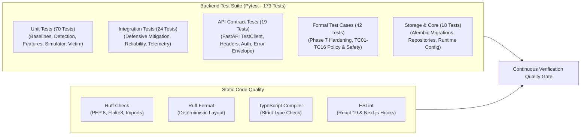

# SENTRIX — Testing & Quality Assurance Guide

**Scope:** Unit Tests, Integration Tests, End-to-End Pipeline Verification, Static Analysis, and Frontend Quality Audits.  

---

## 1. Testing Architecture & Philosophy

The SENTRIX verification harness guarantees system safety, numerical correctness, and API reliability across the defense lifecycle:



---

## 2. Test Suite Directory Structure (173 Tests Total)

```text
backend/tests/
├── conftest.py                             # Pytest fixtures, test database setup & mock generators
├── api/                                    # FastAPI route contract and error handling tests (19 tests)
│   ├── test_api_contracts.py              # Full REST API contracts and schema verification
│   ├── test_error_handling.py             # Error envelope sanitization and status code assertions
│   ├── test_health.py                     # Unauthenticated and authenticated health probes
│   └── test_keepalive.py                  # Database ping and fallback authentication tests
├── core/                                   # Configuration and runtime validator tests (9 tests)
│   └── test_config.py                     # Environment variables, database URL validation, security flags
├── integration/                            # Multi-component pipeline integration tests (24 tests)
│   ├── test_defensive_mitigation.py       # Staged dry-run, approval, Nginx/Caddy config exports
│   ├── test_reliability_and_performance.py# Fail-closed handling, recovery, benchmark latency checks
│   ├── test_simulation_shield_ml_audit.py # Multi-tick simulator, defense shield, audit logging
│   ├── test_tc08_simulation_safety.py     # Pure mathematical simulation without host network mutation
│   ├── test_telemetry_detection.py        # Ingress to sliding window, EWMA, and ML threat evaluation
│   └── test_telemetry_pipeline.py         # Log format parsing (Combined, CLF, JSON) and IP masking
├── storage/                                # Database and migration validation tests (9 tests)
│   ├── test_migrations.py                 # Idempotent Alembic upgrade and downgrade validation
│   └── test_repositories.py               # Repository layer CRUD operations and session lifecycle
├── test_cases/                             # Formal specification test suites (42 tests)
│   ├── test_phase7_security_and_hardening.py # Security invariants, token safety, parameter bounds
│   ├── test_tc01_to_tc07_policy_and_traffic.py # Velocity thresholds, baseline updates, policy consensus
│   ├── test_tc09_tc10_tc12_virtual_lifecycle.py# Virtual rule lifecycle, cooldowns, emergency disable
│   └── test_tc11_to_tc16_lifecycle_and_simulation.py # End-to-end chaos runs, seed determinism, scorecards
└── unit/                                   # Isolated unit tests for algorithms and models (70 tests)
    ├── test_baselines.py                  # Adaptive EWMA moving mean, moving variance, Z-scores
    ├── test_detection.py                  # Model loader, predictor, schema compatibility checks
    ├── test_features.py                   # 14 canonical features extraction, scaling, circular deque
    ├── test_mitigation_cancellation.py    # Mitigation cancellation idempotency and state changes
    ├── test_mitigation_lifecycle.py       # Mitigation state machine transition validation
    ├── test_mitigation_network_status.py  # Host IP resolution, gateway discovery, system status
    ├── test_policy_and_safety.py          # Allowlist protection gate, RFC 1918 safety invariants
    ├── test_simulator_api.py              # Simulator run creation, control, export API handlers
    ├── test_simulator_manager.py          # Virtual clock worker, speed controls, retention pruning
    ├── test_simulator_scenarios.py        # Scenario types (SYN, UDP, HTTP, Slowloris, Flash Crowd)
    ├── test_simulator_scorecard.py        # Scorecard calculation (TTD, TTM, drop efficiency)
    ├── test_simulator_victim.py           # Virtual victim M/M/1 queuing model, bandwidth, CPU saturation
    └── test_threat_classifier.py          # Multi-tier classifier, entropy ratio, flash crowd differentiator
```

---

## 3. Running Backend Tests with Pytest

All backend tests execute against isolated in-memory or temporary SQLite test databases (`sentrix_test.db`).

### Run All 173 Backend Tests:
```powershell
# Windows PowerShell
.\.venv\Scripts\Activate.ps1
python -m pytest backend/tests -v
```
*(Linux/macOS: `pytest backend/tests -v`)*

### Run Specific Sub-Suites:
```bash
# Unit tests only (70 tests):
python -m pytest backend/tests/unit -v

# Integration tests only (24 tests):
python -m pytest backend/tests/integration -v

# API route tests only (19 tests):
python -m pytest backend/tests/api -v

# Formal test cases only (42 tests):
python -m pytest backend/tests/test_cases -v

# Storage & migration tests only (9 tests):
python -m pytest backend/tests/storage -v
```

---

## 4. Static Code Quality & Linting Commands

SENTRIX uses **Ruff** for high-speed Python linting, import sorting, and formatting.

### Check Python Code Quality (Lint):
```bash
python -m ruff check backend
```
*Expected output: All checks passed!*

### Check Python Formatting:
```bash
python -m ruff format --check backend
```
*Expected output: All files properly formatted.*

### Automatically Format Code (if needed):
```bash
python -m ruff format backend
python -m ruff check --fix backend
```

---

## 5. Frontend Quality & TypeScript Typechecking

### Run Strict TypeScript Typecheck:
```bash
npm run typecheck --prefix frontend
```
*Expected output: 0 errors.*

### Run ESLint:
```bash
npm run lint --prefix frontend
```
*Expected output: No lint warnings or errors.*

### Production Build Test:
```bash
npm run build --prefix frontend
```
*Generates optimized standalone Next.js production build compiling all 13 routes.*
